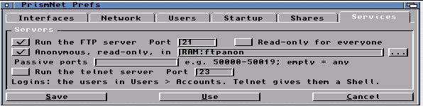
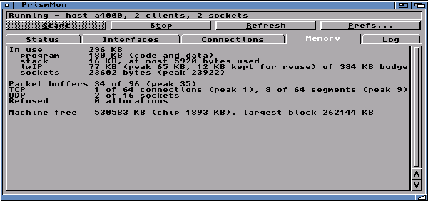
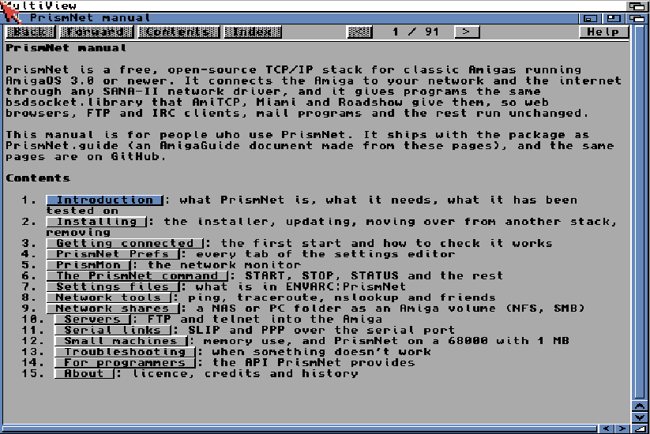

# PrismNet

A free, open-source TCP/IP stack for classic Amigas: AmigaOS 3.1 or newer,
any 68000 or better. PrismNet connects the Amiga to your network and the
internet through any SANA-II network driver, and provides the same
`bsdsocket.library` as AmiTCP, Miami and Roadshow, so the network programs
you already have run unchanged. The networking core is
[lwIP](https://savannah.nongnu.org/projects/lwip/) 2.2.1.

**[Read the manual](docs/manual/README.md)**. It ships in the package as
`PrismNet.guide`, made from the same pages.

## At a glance

| | |
|---|---|
| **Stack** | TCP, UDP, ICMP and raw sockets (lwIP 2.2.1); AmiTCP 4 `bsdsocket.library`; Roadshow API extensions; `usergroup.library` |
| **Hardware** | any SANA-II driver: Ethernet, PCMCIA, SCSI (DaynaPORT), A314, serial SLIP/CSLIP/PPP/PLIP; built-in SLIP over `serial.device` |
| **Addresses** | DHCP or fixed, up to 4 interfaces, default gateway, static routes |
| **Names** | DNS (3 servers, search domain), `hosts` file; the Amiga answers to its name by NetBIOS and mDNS (`amiga.local`) and gives it to DHCP |
| **Clock** | sets the Amiga's time from the network (SNTP) at start-up, or on demand with `PrismNet SETCLOCK` |
| **Starting** | on demand (the first program that needs it), at boot, or by hand; `PrismNet STOP` and `START` |
| **Commands** | `PrismNet STATUS`, `NETSTAT`, `ROUTE`, `ARP`, `LOG`, `SETCLOCK`, `START`/`STOP`, `TRACE=` request log |
| **Tools** | `ping`, `traceroute`, `nslookup` (all record types, mDNS), `httpbench`, `SMBShares`, `ShareUnmount`, `PrismNetUpdate` |
| **GUIs** | PrismNet Prefs (6 tabs, Roadshow import), PrismMon (live status, traffic, connections, memory, log) |
| **Shares** | own NFS v3 and SMB 2/3 clients: a NAS, Windows, macOS or Samba folder as an Amiga volume |
| **Servers** | FTP server, telnet server (AmigaDOS Shell), web server (one folder, read-only), inetd to start them on demand; user accounts with passwords |
| **Memory** | allocated as needed within a budget; ~290 KB idle, or ~175 KB with the small core for 1-2 MB machines |
| **Install** | Amiga Installer: install, update (keeps settings; all questions first, a few seconds offline), remove (puts the old stack's files back) |
| **Updates** | checks GitHub or a mirror for a newer release and installs it (68020+, AmiSSL 5) |
| **Docs** | AmigaGuide manual on the Amiga, the same manual here |
| **Needs** | AmigaOS 3.1 or newer, any 68000 or better |

## Features

### A drop-in stack

- **`bsdsocket.library`** with the AmiTCP 4 API: TCP and UDP sockets,
  `WaitSelect`, non-blocking connects, the resolver (`gethostbyname`,
  `getaddrinfo`, `getnameinfo`), `sendmsg`/`recvmsg`, socket events,
  `ReleaseSocket`/`ObtainSocket`, `SocketBaseTagList`. Every program gets
  its own library base, with its own sockets, errno and signals.
- **Roadshow's extensions**: interface, route, DNS and statistics queries
  (`ObtainInterfaceList`, `QueryInterfaceTagList`, `GetNetworkStatistics`,
  `GetRouteInfo`, ...) and the configuration calls that change routes,
  interfaces and name servers at run time.
- **`usergroup.library`**, the AmiTCP user and group API, for programs that
  ask who the user is, and for logins to PrismNet's own servers.
- **Runs what you have**: AWeb, IBrowse, Amelinium, wget, AmiSSL (HTTPS),
  FTP and IRC clients, mail programs and telnet BBSes.

### Networking

- **Any SANA-II driver**: Ethernet cards (X-Surf, ZZ9000, PCMCIA NE2000),
  SCSI adapters (DaynaPORT), the A314, and serial SLIP, CSLIP, PPP or PLIP.
  SLIP also runs straight over the serial port, with no driver at all.
- **Up to four interfaces at once**, each with DHCP or a fixed address.
- **Names**: DNS (up to three servers, a search domain), a `hosts` file,
  and an `nslookup` that asks mDNS for `.local` names. Other machines find
  the Amiga by name too: NetBIOS for Windows, mDNS (`amiga.local`) for
  macOS and Linux.
- **Static routes**, a default gateway, `PrismNet ROUTE` and `PrismNet ARP`
  to see them.
- **Network time**: sets the Amiga's clock from the time server DHCP offers,
  or one you name, in the Locale prefs' time zone.

### Starts when it is needed

- The first program that opens `bsdsocket.library` starts PrismNet and
  waits for an address. Or start it at boot, or by hand with
  `PrismNet START`.
- `PrismNet STOP` closes everything and lets go of the card; `START` brings
  it back.

### Settings and monitoring

- **PrismNet Prefs**, a settings editor with six tabs: Interfaces,
  Network, Users, Startup, Shares and Services. It can import a Roadshow
  setup, and restarts the stack for you when settings change.
- **PrismMon**, a live monitor: status, interfaces with traffic, every
  open connection with the program that owns it, memory use against the
  budget, and the log. Start and Stop buttons, copy to the clipboard.
- **Plain text settings** in `ENVARC:PrismNet`, with commented examples, for
  anyone who prefers an editor.

### Network shares

- **Its own NFS client** (NFS version 3 over TCP) for a NAS or Linux, and
  **its own SMB client** (SMB 2.0.2 to 3.1.1, with signing and encryption)
  for Windows, macOS, a NAS or Samba. Shares mount as ordinary Amiga
  volumes that every program can use.
- Set up in Prefs, with **Browse...** to pick an SMB share from the
  server's list; mounted at boot or on first use; they connect only when
  used and reconnect by themselves.
- The SMB password is asked once, in a masked window, and remembered.
- `SMBShares` lists a server's shares from the Shell.

### Servers

- **FTP server**: any FTP client (FileZilla, WinSCP, `ftp`) sees the Amiga's
  volumes as folders. Logins are PrismNet's users; optional anonymous,
  read-only access to one drawer; passive and active mode; firewall
  settings for passive ports.
- **Telnet server**: log in from any terminal and get an AmigaDOS Shell
  in your home drawer, with line editing and CTRL-C.
- **Web server**: one folder of the Amiga in any browser, read-only, no
  login; a folder's `index.html` or a list of its files, resumable
  downloads.
- All three are started on demand by PrismNet's own **inetd**, which PrismNet
  starts and stops with itself. Nothing listens unless you switch a server
  on. Account passwords are set in Prefs.

### Small machines

- Memory is taken as traffic needs it and given back, within a budget you
  can set. About 290 KB when idle.
- A **small core** for 68000 machines with 1 to 2 MB uses about 175 KB; the
  installer offers it when memory is short.

### Tools

`ping`, `traceroute` (ICMP or UDP), `nslookup` (any record type, mDNS for
`.local`), `httpbench` (throughput and connection-rate benchmark), and
`PrismNet STATUS`, `NETSTAT`, `LOG`, `ROUTE` and `ARP`. The tools work with
any AmiTCP-compatible stack.

### An installer, and a manual

- **Install_PrismNet** installs, updates (keeping your settings) and
  removes. It saves another stack's libraries and tools and puts them back
  on removal, asks for your driver and address, and offers the optional
  parts: the share clients and the servers. It asks everything before it
  touches anything, and an update takes the network away for a few seconds.
- **PrismNetUpdate** checks for a newer release (from PrismNet Prefs or a
  Shell) and can download and install it.
- **The manual**, as an AmigaGuide on the Amiga and as pages here.

## Tested on

| Machine | Network |
|---|---|
| Amiga 4000, 68060 | ZZ9000 Ethernet |
| Amiga 2000, 68030 | X-Surf ([xsurfnet.device](https://github.com/lainejones/XSurfNet) and `x-surf.device`) |
| Amiga 1200, 68030 | A314; ZuluSCSI DaynaPORT |
| Amiga 500, 68030 | BlueSCSI DaynaPORT |
| CD32, 68030 | built-in SLIP over `serial.device` (115200 baud) |
| WinUAE, OS 3.2 | NE2000 PCMCIA, X-Surf |

## Installing

Unpack `PrismNet-<version>.lha` and double-click `Install_PrismNet`. See
[Installing](docs/manual/02-installing.md), including how to move over from
Roadshow, AmiTCP or Miami.

## Documentation

| | |
|---|---|
| [Manual](docs/manual/README.md) | for users: installing, Prefs, commands, settings, shares, servers, troubleshooting |
| [DEVELOPING.md](docs/DEVELOPING.md) | source layout, building, testing, releasing |
| [DESIGN.md](docs/DESIGN.md) | architecture and design decisions |
| [PERFORMANCE.md](docs/PERFORMANCE.md), [CONFORMANCE.md](docs/CONFORMANCE.md) | speed against Roadshow; protocol conformance |
| [NFSCLIENT.md](docs/NFSCLIENT.md), [SMBCLIENT.md](docs/SMBCLIENT.md), [SHARES.md](docs/SHARES.md) | the share clients' design and test results |
| [SERVERS.md](docs/SERVERS.md) | inetd, ftpd, telnetd and httpd internals and tests |
| [AUDIT.md](docs/AUDIT.md) | API audit against AmiTCP, Roadshow and real programs |

## Not there yet

IPv6, alias addresses, and the bpf, mbuf and network-monitor hooks and DHCP
address messages (they exist and return 0).

**Known issue:** on the CD32's `slip.device` 37.4 (1993), `PrismNet STOP`
followed by `START` can leave the stack stuck opening the driver until a
reboot. PrismNet's built-in SLIP doesn't have the problem and is as fast; see
[Serial links](docs/manual/11-serial.md) for moving over.

## Licence

PrismNet: GNU GPL version 3 (GPL-3.0-only), see [LICENSE](LICENSE). lwIP:
BSD-3, see [lwip/COPYING](lwip/COPYING).
